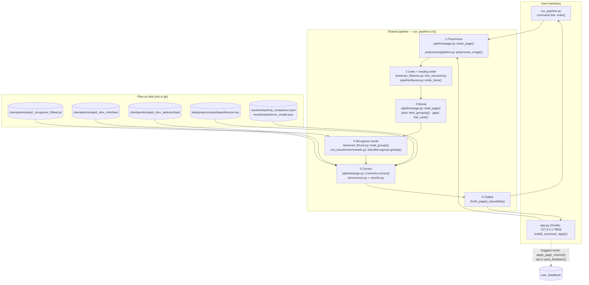
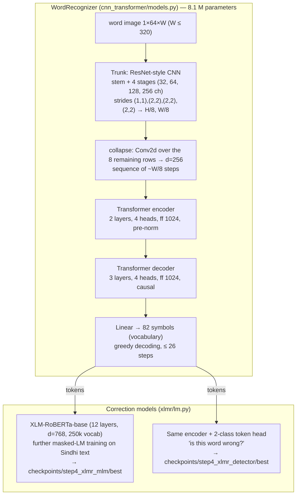

# 02 — System architecture (reconstructed from the source code)

Every stage below names the file and function that implements it. Line numbers drift as code changes; search for
the function name. Evidence was taken from the code at commit `fbe4a5b` (2026-11-16).

---

## 1. What the system does

| Question | Answer (from the code) |
|---|---|
| Problem solved | Convert a **photo of a handwritten Sindhi page** into **Unicode Sindhi text** (Perso-Arabic script, right to left). |
| Input | One or more page images in any format Pillow reads (JPG, PNG, TIFF, WEBP…). Pages must be **upright**. The web app accepts one image at a time and refuses images whose shorter side is < 120 px (`pipeline/present.py::check_image`). |
| Output | Text (one line of text per found text line), plus a JSON with line boxes, word boxes, the recognizer's readings, the corrected words, the action taken on each word, suggestions (Suggest mode) and warnings (`run_pipeline.py::main`). The web app shows the same and offers a `.txt` download. |
| Where it runs | Locally on the owner's Mac (Apple M2, 8 GB RAM), CPU or Apple GPU (MPS). No internet, no cloud API, no Claude/AI service needed at run time. |

---

## 2. System architecture



---

## 3. Data flow (what each stage receives and produces)


---

## 4. Step-by-step execution flow (command line)

`python run_pipeline.py page.jpg --out pipeline_out/`

1. **Environment limits** — on import, `run_pipeline.py` sets `PYTORCH_MPS_HIGH_WATERMARK_RATIO` (0.7, from
   `configs/step4_xlmr.yaml: mps_memory_ratio`) and `HF_HUB_OFFLINE=1` so nothing is fetched from Hugging Face.
2. **Gates** — `main()` calls `common/gates.py::require_gate()` for `step1_preprocessing`, `step2_cnn_transformer`,
   `step3_tesseract`, `step4_xlmroberta` (accepted FAILs pass with a printed warning).
3. **Load + clean** — `pipeline/page.py::load_rgb()` (EXIF rotation, transparency → white) then `clean_page()`:
   `preprocess_image(rgb, profile="page")` → optional curved-ruling removal (`--erase-rules`,
   `cnn_transformer/segment.py::erase_ruled_lines`) → connected components → `tesseract_ft/pages.py::filter_comps`
   (drop specks < 6 px and edge-touching blobs) → optional circled-number removal (`--remove-circled`) →
   `keep_only()` returns a page containing only the kept ink.
4. **`run_pipeline.run()`** — loads the recognizer (`load_recognizer()` → `scripts/step3_baseline.py::load_recognizer`,
   checkpoint `checkpoints/step2_recognizer_ft/best.pt`), then per page calls `pipeline/page.py::read_page()`:
   1. `tesseract_ft/boxes.py::line_structures(binary, "tracked")` finds text lines (a line finder that follows
      sloped lines) and, inside each line, **ink spans** (runs of connected ink, right to left) with their dots.
   2. `pipeline/layout.py::order_lines()` orders the line pieces: pieces that overlap vertically ≥ 60 % and
      horizontally ≤ 75 % are one row; rows top→bottom, pieces right→left (chosen in `scripts/step5_order.py`).
   3. Words: `line_units()` gives the units — single spans (`--words joins`, default) or the gap rule's pieces
      (`--words gaps`: cut where gap > max(0.3 × letter height, 0.75 × median gap)).
   4. `tesseract_ft/cuts.py::read_groups()` cuts each candidate group's own ink, resizes it to 64 px high
      (≤ 320 px wide) and runs `WordRecognizer.greedy()`; it returns the text and the mean log-probability.
   5. `best_grouping()` (dynamic programming) keeps the grouping of units (≤ 6 spans per word) with the best total
      log-probability. With `gaps`, every piece is one word.
5. **Plausibility** — `pipeline/page.py::plausibility()` warns if found line boxes are stacked ≥ 2.5 deep (or
   ≥ 20 boxes ≥ 2.0 deep) or ≥ 30 % of ≥ 30 words are single letters.
6. **Correction** (`--correct auto`, default) — `Corrector.correct()`:
   1. `xlmr/correct.py::build_positions()` — for every token: keep candidate + replacements from the lexicon
      within a weighted edit distance (`Lexicon.near`, `wdist`), splits into two known words, merges with the next
      token.
   2. `xlmr/lm.py::MaskedScorer.score()` — loads the Sindhi-trained XLM-R masked LM, replaces each token by k
      `<mask>` tokens and scores every candidate in context; then the model is freed (`free()`).
   3. `xlmr/lm.py::Detector.probs()` — loads the "is this word wrong?" token classifier; flags tokens with
      probability > θ.
   4. `xlmr/correct.py::decide()` — score = −α·edit cost + β·log frequency − η·unknown + γ·LM score; replace when
      the best candidate beats keeping by `tau_oov` (unknown/flagged word) or `tau_known`. Weights:
      `results/step4/val_comparison.json`.
   - `--correct suggest`: `xlmr/correct.py::suggest()` lists what `decide` would change with the top-3 candidates,
     changes nothing. `--correct off`: no correction.
7. **Output** — `finish_page()` writes per-line words and the text; `main()` writes `<name>.txt` and `<name>.json`
   and prints any warning to stderr.

### Web app flow (`app.py`)

```mermaid
sequenceDiagram
    actor U as User (browser)
    participant G as Gradio server (app.py, 127.0.0.1)
    participant P as run_pipeline.run()
    U->>G: upload photo (img.change → on_upload: clear old results)
    U->>G: Read page (mode, word finding)
    G->>G: present.check_image(); clean_page(load_rgb())
    G->>P: run([binary], correct=mode, words=..., progress=callback)
    P-->>G: page dict
    G-->>U: screen 2: summary, final text, boxes images, compare, review cards
    U->>G: Suggest mode: Apply choices (picks, save?)
    G->>G: apply_page_choices(); optional save_feedback() → user_feedback/
    G-->>U: updated text, highlights, .txt
    U->>G: ← Read another page (read_another: clear upload + results)
```

**How the frontend talks to the backend:** Gradio serves a web page on `http://127.0.0.1:7860`; button clicks
call the Python functions `process`, `apply`, `toggle_boxes`, `bulk`, `read_another` over Gradio's local HTTP/
websocket queue (`concurrency_limit=1`: one page at a time). The page state (cleaned page, page dict, image path)
is kept per browser session in a `gr.State`. Nothing leaves the computer: `server_name="127.0.0.1"`,
`share=False`, `GRADIO_ANALYTICS_ENABLED=False`, theme fonts are local system fonts.

---

## 5. Model architecture (as used at inference)



The trunk of the WordRecognizer has the same layout as the 52-letter `LetterCNN` and was initialised from it
(`cnn_transformer/models.py::load_trunk_from_letter_cnn`). Full layer-by-layer details:
`03_MODEL_AND_ALGORITHMS.md`.

---

## 6. How datasets and models connect to the application

| Needed at run time | Path | Made by |
|---|---|---|
| Word recognizer weights + vocabulary | `checkpoints/step2_recognizer_ft/best.pt` | `scripts/step2_train_recognizer.py --finetune` |
| Sindhi masked LM | `checkpoints/step4_xlmr_mlm/best/` | `scripts/step4_train_mlm.py` |
| Wrong-word detector | `checkpoints/step4_xlmr_detector/best/` | `scripts/step4_train_detector.py` |
| Lexicon (47,422 words) | `data/preprocessed/step4/lexicon.tsv` | `scripts/step4_prepare.py` |
| Confusion table / error model | `results/step4/error_model.json` | `scripts/step4_prepare.py` |
| Correction variant + weights | `results/step4/val_comparison.json` | `scripts/step4_compare.py` |
| Settings | `configs/*.yaml` (`step1_preprocess`, `step3_tesseract: box_finder`, `step4_xlmr`) | hand-written |
| Gate files (checked at start) | `results/gates/*.json` | each step's script |
| Example page for the app | `data/raw/handwritten/images/A1.png` (training page) | dataset copy |

Datasets are **not** needed to run the app except the lexicon and A1 (example button). They are needed to retrain.

---

## 7. Technologies and why they are used

| Technology | Version (requirements.txt) | Role |
|---|---|---|
| Python | 3.13.3 | language |
| OpenCV (`opencv-python-headless`) | 5.0.0.93 | image operations: connected components, morphology, drawing boxes |
| scikit-image | 0.26.0 | Sauvola thresholding, skew/other image utilities |
| NumPy / Pillow | 2.5.4 / 12.3.0 | arrays, image loading (EXIF, formats) |
| PyTorch (+ torchvision) | 2.14.1 / 0.29.1 | CNN + Transformer recognizer; Apple GPU via MPS |
| Hugging Face `transformers`, `tokenizers`, `safetensors`, `accelerate` | 5.23.0 / 0.23.3 / 0.8.0 / 1.15.0 | XLM-RoBERTa loading, Trainer for MLM and detector training |
| Gradio (+ fastapi, uvicorn) | 6.32.0 | local web app |
| PyYAML | 6.0.3 | configs |
| pyarrow / pandas | 26.0.0 / 3.1.1 | reading the Wikipedia parquet; Gradio dependency |
| Tesseract 5.5.2 (system) | — | not used by the pipeline; evaluated as a box finder in Step 3, and its `text2image` tool rendered the printed word images used to train the recognizer |
| rembg + onnxruntime | 2.0.85 / 1.31.0 | compared in Step 1 only; **not used** by the pipeline |
| pytest | 9.1.1 | 79 unit tests |
| git | — | version history (local only, no remote) |
